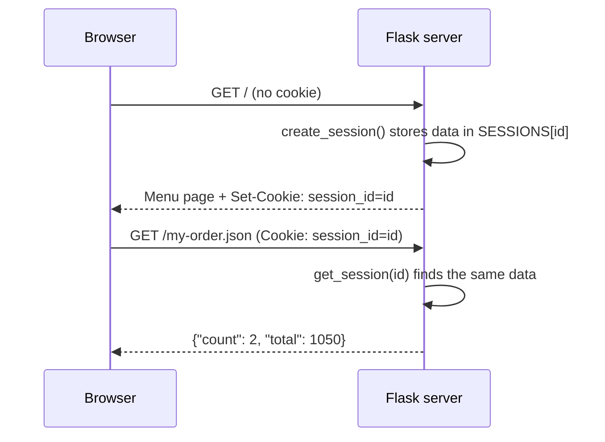

# Flask PWA - Memory and Session Management Task

This task uses a **school canteen ordering app**, built as a Flask Progressive Web App (PWA), to make two abstract ideas **visible**: **memory management** and **session management**.

At lunchtime hundreds of students order at once, and each one needs their own order to be remembered between pages. That makes a canteen app a good example of why these ideas matter. The app ships in a deliberately **inefficient** state. You will fix it step by step and watch the impact live on a dashboard called the **Memory & Session Lab**.

> [!Note]
> **Syllabus dot point:** Design, develop and implement code considering efficient execution for the user, including:
>
> - memory management
> - session management

You will work on both sides of the app:

|              | Server side (Flask, Python)                    | Client side (browser, JavaScript)           |
| ------------ | ---------------------------------------------- | ------------------------------------------- |
| **Memory**   | Data held in the Python process for every user | DOM nodes, `localStorage`, Cache API        |
| **Sessions** | Session IDs, expiry, regeneration, destruction | Cookies, `sessionStorage` vs `localStorage` |

Every step follows the same pattern:

1. 🔮 **Predict** what will change on the dashboard.
2. 🛠️ **Change** the code.
3. 👀 **Observe** the dashboard.
4. 💬 **Explain** what happened and why.

---

## Requirements

1. [VS Code](https://code.visualstudio.com/download) or [GitHub Codespaces](https://github.com/features/codespaces)
2. [Python 3.x](https://www.python.org/downloads/)
3. [Git 2.x.x +](https://git-scm.com/downloads)
4. [SQLite3 Editor](https://marketplace.visualstudio.com/items?itemName=yy0931.vscode-sqlite3-editor)
5. Chrome or Edge is recommended. The lab's "JS heap" column only works in these browsers.
6. pip installs:

```bash
pip install -r requirements.txt
```

> [!Important]
> macOS and Linux users may need `pip3` and `python3` instead of `pip` and `python`.

## Using Git for Version Control

Commit after every step so you can compare before and after, and roll back if something breaks.

```bash
git add .
git commit -m "Step 4: remove per-user page cache"
git push
```

> [!Tip]
> Put the step number in each commit message. Your Git history becomes a record of every efficiency improvement you made.

---

## How this project is organised

```text
├── database
│   └── canteen.db              # The menu and placed orders (SQLite)
├── docs
│   └── README.md               # These instructions
├── memory_lab                  # ⛔ The Memory & Session Lab dashboard: DO NOT EDIT
├── static
│   ├── css
│   ├── icons
│   ├── images
│   ├── js
│   │   ├── app.js              # ✏️ Client code you will improve
│   │   ├── bootstrap.bundle.min.js
│   │   └── serviceWorker.js    # ✏️ Service worker you will improve
│   └── manifest.json
├── templates                   # Jinja2 templates (no changes needed)
├── database_manager.py         # ✏️ Database queries you will improve
├── main.py                     # ✏️ Flask routes you will improve
├── requirements.txt
└── session_store.py            # ✏️ Server-side session store you will improve
```

### Finding your way around the code

Every function has a **docstring** (the text in `"""triple quotes"""` or `/** ... */` straight under the function name). It explains what the function does and **which README steps change it**. For example:

```python
@app.before_request
def log_request():
    """Record every request in REQUEST_LOG before Flask runs the route.

    README Step 7 limits how much this log can hold.
    """
```

> [!Tip]
> To find everything a step changes, search the whole project for the step number: press `Ctrl+Shift+F` (`Cmd+Shift+F` on macOS) and search for `Step 7`.

### The routes in `main.py`

| Route               | Method | Function           | What it does                                                         |
| ------------------- | ------ | ------------------ | -------------------------------------------------------------------- |
| `/`                 | GET    | `index()`          | Shows the menu (with an optional `?category=` filter) and your order |
| `/add`              | POST   | `add_item()`       | Adds one item to your order                                          |
| `/remove`           | POST   | `remove_item()`    | Removes one item from your order                                     |
| `/place-order`      | POST   | `place_order()`    | Saves your order in the database (you must be signed in)             |
| `/login`            | POST   | `login()`          | Signs you in with your first name                                    |
| `/logout`           | POST   | `logout()`         | Signs you out                                                        |
| `/my-order.json`    | GET    | `my_order()`       | Returns a summary of your order. Every open tab asks every 2 seconds |
| `/privacy.html`     | GET    | `privacy()`        | Shows the privacy policy                                             |
| `/offline.html`     | GET    | `offline()`        | The page shown by the service worker when you are offline            |
| `/serviceWorker.js` | GET    | `service_worker()` | Serves the service worker from the site root                         |

Three functions run for **every** request, not just one route:

- `log_request()` runs **before** each route (it is decorated with `@app.before_request`).
- `current_session()` is called at the start of most routes to find (or create) the user's session.
- `add_headers()` runs **after** each route (it is decorated with `@app.after_request`) to add the session cookie and security headers to the response.

### The Memory & Session Lab

The `memory_lab` folder is a measuring tool, like an oscilloscope in an electronics class. You do not need to read it to complete the task, but every function in it has a docstring explaining how it works if you are curious. It is attached to your app with these two lines in `main.py`:

```python
from memory_lab import attach_lab
```

```python
attach_lab(app)
```

The lab:

- serves the dashboard at `/lab`
- measures the Python process using [`tracemalloc`](https://docs.python.org/3/library/tracemalloc.html)
- finds your `SESSIONS` dictionary, module-level lists and caches
- adds a small coloured **badge** to the bottom-right of every app page showing which **session** and **tab** that page belongs to

> [!Caution]
> The lab shows private details of every session. It is a teaching tool and must **never** be deployed to a real website.

---

## Key ideas before you start

### What is memory management?

Memory (RAM) is fast, limited storage that a running program uses for its data. **Memory management** means:

1. Only keeping data you actually need.
2. Sharing one copy of data instead of making many copies.
3. Putting a limit (a **bound**) on anything that can grow.
4. Releasing data when you are finished with it.

**Analogy: the canteen counter.** A sensible canteen has one menu board on the wall that everyone reads, and one order docket per student. An inefficient canteen prints a full copy of the menu for every student, photocopies every docket "just in case", and never throws any paper away. It works with 5 students. At lunchtime with 500 students, the counter is buried in paper.

**How Python manages memory:**

- Every value (string, list, dictionary) is an object stored in an area of memory called the **heap**.
- Python counts how many **references** point to each object. When the count reaches zero, the memory is freed automatically (**garbage collection**).
- A **memory leak** in Python is usually not "forgotten" memory. It is memory that is **still referenced** but **no longer needed**, for example items added to a global list that is never trimmed.
- In a Flask server, **module-level** variables (like `SESSIONS = {}`) live until the server stops and are **shared by every user**. Whatever you store per user is multiplied by the number of users.

You can see references at work in this short example:

```python
order = ["pie", "juice"]  # Python creates one list. 1 reference points to it.
backup = order  # Still ONE list in memory, now with 2 references.
order = []  # 1 reference left (backup), so the list stays in memory.
backup = []  # 0 references left, so Python frees the list's memory.
```

**How the browser manages memory:**

| Storage                    | Lives in                              | Shared between tabs? | Lasts until                   |
| -------------------------- | ------------------------------------- | -------------------- | ----------------------------- |
| JS variables and the DOM   | Tab memory (JS heap)                  | No                   | Tab is closed or page reloads |
| `sessionStorage`           | Browser storage                       | No, one per tab      | Tab is closed                 |
| `localStorage`             | Browser storage (about 5 MB per site) | Yes                  | Deleted by code or the user   |
| Cache API (service worker) | Browser storage                       | Yes                  | Deleted by code or the user   |
| Cookies                    | Browser storage, sent with requests   | Yes                  | Expiry date or browser closes |

The **DOM** (Document Object Model) is the browser's copy of the page's HTML. Every element on the page (a `<div>`, a `<li>`, a button) is a **DOM node** that uses memory in that tab.

### What is session management?

HTTP is **stateless**: each request is independent and the server does not remember you. A **session** lets the server recognise the same user across many requests, so your order is still there when you load the next page.

**Analogy: the order docket number.** You place your order and get a docket number (the **session ID**). Each time you come back to the counter you show the number, and staff find your order. For this to be safe:

- Docket numbers must be **impossible to guess**, or anyone could collect your lunch.
- The docket must be **protected**, so nobody can copy it.
- Old dockets must **expire**, so the counter does not fill up with orders nobody collects.
- You get a **new number** when your status changes (for example you sign in), so an old copied number becomes useless.
- When you leave, your docket is **destroyed**.



There are two common ways to store session data:

|                               | Server-side session (this app's `SESSIONS`) | Client-side session (Flask's built-in `session`)    |
| ----------------------------- | ------------------------------------------- | --------------------------------------------------- |
| Where the data lives          | Server memory or a database                 | Inside a signed cookie in the browser               |
| What the cookie holds         | Only a random ID                            | All the data, signed so it cannot be altered        |
| Server memory per user        | Grows with every user                       | None                                                |
| Size limit                    | Server memory                               | About 4 KB per cookie                               |
| Can the server end a session? | Yes, delete it                              | Not easily, the cookie stays valid until it expires |

This app uses **both**. Your `session_store.py` is a server-side store. Flask-WTF uses Flask's built-in client-side `session` cookie to hold the CSRF token that protects the forms.

### New code you will meet

You will see some Python, Flask and JavaScript features that may be new to you. Come back to this table whenever you need to.

| Code                                         | What it means                                                                                                           |
| -------------------------------------------- | ----------------------------------------------------------------------------------------------------------------------- |
| `@app.before_request` / `@app.after_request` | Decorators (like `@app.route`) that tell Flask to run a function before or after **every** route                        |
| `g`                                          | Flask's notepad for the current request. Anything saved in `g` (e.g. `g.session_id`) is forgotten when the request ends |
| `request.cookies.get("session_id")`          | Reads a cookie the browser sent with the request (`None` if there is no such cookie)                                    |
| `response.set_cookie(...)`                   | Tells the browser to save a cookie, which it then sends back with every request                                         |
| `global next_id`                             | Lets a function change a variable defined at the top of the file, instead of making a new local variable                |
| `("pie", "juice")`                           | A **tuple**: like a list, but it cannot be changed after it is made                                                     |
| `SESSIONS.pop(session_id, None)`             | Removes a key from a dictionary. The `None` means "don't crash if the key is not there"                                 |
| `time.time()`                                | The current time as a number of seconds, so subtracting two times gives the seconds between them                        |
| `@lru_cache(maxsize=8)`                      | A decorator from `functools` that remembers a function's results (Step 6)                                               |
| `deque(maxlen=100)`                          | From `collections`: a list that can never hold more than 100 items (Step 7)                                             |
| `secrets.token_urlsafe(32)`                  | Makes a long random string that is impossible to guess (Step 11)                                                        |
| `async function` / `await fetch(...)`        | JavaScript: wait for the server to reply without freezing the page                                                      |
| `localStorage.setItem(key, value)`           | JavaScript: save text in the browser under a name (the key). Saving with the same key again replaces the old value      |

---

## Part 1: Run the lab and record a baseline

### Step 1: Start the app

```bash
python main.py
```

Open the forwarded port 5000 in your browser (in Codespaces, use the **Ports** tab or the pop-up). You should see the canteen menu. Click **Lab dashboard** in the menu bar to open the lab in a new tab.

> [!Important]
> The finished app uses `Secure` cookies, which browsers only accept over **HTTPS** or on **localhost**. Codespaces gives you HTTPS automatically. Running on your own computer, use `http://localhost:5000`.

> [!Note]
> Flask's debug mode restarts the server every time you save a `.py` file. Restarting **clears all server memory, including every session and order in progress**. This is useful: each code change starts from a clean slate.

### Step 2: Take a tour of the dashboard

Open **How to read this dashboard** at the top of the lab. Then open each **What does this show?** link. Every panel explains what it measures.

| Panel                             | What it shows                                                                                    |
| --------------------------------- | ------------------------------------------------------------------------------------------------ |
| **Key numbers**                   | Python heap, memory allocated by your code, process memory, sessions, open tabs, browser storage |
| **Server memory chart**           | The whole Python heap (blue) and memory allocated by **your** code (red) over the last 3 minutes |
| **Client memory chart**           | DOM nodes across all open tabs, Cache API entries and `localStorage` keys                        |
| **Scorecard**                     | One check per README step. ✘ red = not fixed, ✔ green = fixed, … grey = do something to test it  |
| **Server sessions**               | One tile per session: size, ID strength, idle time, name, open tabs and the keys stored          |
| **Where is server memory going?** | The exact lines of **your** code that allocated memory that is still in use                      |
| **Module-level data**             | Lists, dictionaries and deques at the top level of your files, with item counts and sizes        |
| **Open tabs**                     | Every open app tab, its session, DOM node count and `sessionStorage` size                        |
| **Cookies**                       | Each cookie your server sets and its security flags                                              |
| **Browser storage**               | `localStorage`, Cache API caches and the browser's own storage estimate                          |

### Simulating more customers

You cannot easily open the app on 50 different devices, so the lab can do it for you. Click **+10 customers** or **+50 customers** at the top of the dashboard. Each click adds that many customers on top of the ones already there.

- Each simulated customer is like a student on their **own phone**, so they get their **own session**.
- Each one views the menu, adds 1 to 3 items and about half sign in. Then they leave.
- The requests go through your real code, so the memory and session numbers are real. What happens to their sessions after they leave is up to your code.

### Step 3: Experiment and record a baseline

Do each experiment and record the numbers in a table like the one below. You will fill in the other columns as you go.

1. Leave **one** menu tab open for 2 minutes. Watch both charts.
2. Click **New tab (same session)** twice. Compare the badges in the bottom-right corner of each tab, and look at your session tile's **Tabs** line.
3. Open the app in a **private/incognito window** (or a different browser). Compare its badge.
4. Add some items to your order, then sign in with your first name. Watch your session tile.
5. Click **+50 customers** twice. Watch the session tiles and the server memory chart, then wait 3 minutes and look again.

| Measurement                                | Baseline | After Part 2 | After Part 3 | After Part 4 |
| ------------------------------------------ | -------- | ------------ | ------------ | ------------ |
| Allocated by your code after 100 customers |          |              |              |              |
| Average size of one session (KB)           |          |              |              |              |
| Sessions still in memory 3 minutes later   |          |              |              |              |
| `main.REQUEST_LOG` items after 2 minutes   |          |              |              |              |
| DOM nodes in one tab after 2 minutes       |          |              |              |              |
| `localStorage` keys after 2 minutes        |          |              |              |              |
| Cache API entries after 2 minutes          |          |              |              |              |
| Scorecard checks passed                    |          |              |              |              |

> 💬 **Explain:** Why did the new **tab** show the **same** session as your first tab, but the private window showed a **different** session? Why does each tab still have a different **tab ID**? (Hint: look at the browser storage table in "Key ideas".)

#### ✅ Checkpoint: Baseline recorded

```bash
# You should have observed:
# - Server memory climbing steadily, even with one tab open
# - Each simulated customer using about 100 KB of server memory
# - Their sessions staying in memory forever after they leave
# - Session IDs that are small counting numbers (1, 2, 3...)
# - DOM nodes, localStorage keys and Cache API entries all climbing
# - Almost every scorecard check red
```

---

## Part 2: Memory management on the server

### Step 4: Stop caching every page for every user

🔮 **Predict:** Look at the **Where is server memory going?** table. Which line uses the most memory? What will happen to the session tiles if we stop storing it?

The starter code saves a copy of every menu page it sends into the user's session, "for a future history feature". That feature does not exist, so this memory is used for nothing. Each copy is about 85 KB and is never released.

> [!Note]
> **Why 85 KB for a page of about 22,000 characters?** Python stores each character of a string in 1, 2 or 4 bytes. If a string contains even one emoji (like 🍔), Python uses 4 bytes for **every** character in it. 22,000 characters × 4 bytes ≈ 85 KB.

🛠️ **Change:** In `main.py`, find `index()` (its docstring mentions **Steps 4 and 5**) and replace it.

Before:

```python
@app.route("/", methods=["GET"])
def index():
    """Show the canteen menu and the user's current order.

    README Steps 4 and 5 change where the menu comes from.
    """
    data = current_session()
    category = selected_category()
    menu = [item for item in data["menu"] if category in ("%", item["category"])]
    items, total = order_details(data["order"])
    html = render_template(
        "index.html",
        data=data,
        menu=menu,
        categories=CATEGORIES,
        category=category,
        items=items,
        total=total,
        placed=request.args.get("placed", type=int),
    )
    data["page_cache"].append(html)
    return html
```

After:

```python
@app.route("/", methods=["GET"])
def index():
    """Show the canteen menu and the user's current order.

    README Steps 4 and 5 change where the menu comes from.
    """
    data = current_session()
    category = selected_category()
    menu = [item for item in data["menu"] if category in ("%", item["category"])]
    items, total = order_details(data["order"])
    return render_template(
        "index.html",
        data=data,
        menu=menu,
        categories=CATEGORIES,
        category=category,
        items=items,
        total=total,
        placed=request.args.get("placed", type=int),
    )
```

In `session_store.py`, remove the `page_cache` line from `create_session()`.

Before:

```python
        "menu": dbHandler.menu_get("%"),
        "page_cache": [],
    }
```

After:

```python
        "menu": dbHandler.menu_get("%"),
    }
```

👀 **Observe:** Save both files (the server restarts), reload the menu tab, then click **+50 customers**.

- The `html = render_template(` line disappears from **Where is server memory going?**
- Session tiles drop from hundreds of KB to about **11 KB**, and they no longer grow when a tab reloads the menu.

💬 **Explain:** Why is "store it just in case" a poor design choice for a server with hundreds of users at lunchtime?

### Step 5: Share the menu instead of copying it

🔮 **Predict:** Each session still has a `menu` key. How many copies of the same menu exist after you click **+50 customers**?

Every customer gets their own full copy of the menu when their session is created. The menu is the same for everyone, so it should be stored once and shared. A session should only hold data that is **unique to that user**: their name and the **IDs** of the items in their order.

🛠️ **Change:** In `session_store.py`, remove the menu copy and the import it needed.

Before:

```python
import time

import database_manager as dbHandler

SESSIONS = {}
next_id = 1


def create_session():
    """Create a session for a new visitor and return its session ID.

    README Steps 4, 5 and 11 change this function.
    """
    global next_id
    session_id = str(next_id)
    next_id += 1
    SESSIONS[session_id] = {
        "name": None,
        "order": [],
        "created": time.time(),
        "last_seen": time.time(),
        "menu": dbHandler.menu_get("%"),
    }
    return session_id
```

After:

```python
import time

SESSIONS = {}
next_id = 1


def create_session():
    """Create a session for a new visitor and return its session ID.

    README Steps 4, 5 and 11 change this function.
    """
    global next_id
    session_id = str(next_id)
    next_id += 1
    SESSIONS[session_id] = {
        "name": None,
        "order": [],
        "created": time.time(),
        "last_seen": time.time(),
    }
    return session_id
```

In `main.py`, inside `index()`, get the menu from the database instead of the session copy.

Before:

```python
    menu = [item for item in data["menu"] if category in ("%", item["category"])]
```

After:

```python
    menu = dbHandler.menu_get(category)
```

👀 **Observe:** Reload the menu and click **+50 customers** again.

- Session tiles drop to about **0.6 KB**. The tile's `keys:` line only lists `created, last_seen, name, order`.
- ✔ **Sessions store only what they need** turns green.
- ✘ **Shared data is cached once** is still red. Every page view now runs a database query.

💬 **Explain:** We saved memory, but now every request queries the database, which takes time. Efficient execution is about balancing **memory** and **speed**. The next step gets both.

### Step 6: Cache shared data once with a bounded cache

🔮 **Predict:** There are only 5 possible menu filters ("All" plus 4 categories). How many different query results can there ever be?

[`functools.lru_cache`](https://docs.python.org/3/library/functools.html#functools.lru_cache) remembers the result of a function for each set of arguments. The next call with the same arguments returns the stored result instantly, without running the function again. `maxsize` **bounds** the cache: when it is full, the **L**east **R**ecently **U**sed result is thrown away. You add it with a decorator, `@lru_cache(maxsize=8)`, on the line above the function, just like `@app.route` above a route.

There is one rule when sharing data between users: **no user may change it**. Returning a `tuple` (which cannot be changed) instead of a `list` protects the shared copy. The code inside `tuple(...)` is the same as the list comprehension you already have, with round brackets instead of square brackets.

We also fix how database connections are closed. In the API task you used `with sql.connect(...)`. For SQLite, the `with` block **saves (commits)** your changes when it ends, but it does **not close** the connection, so each connection stays in memory until Python cleans it up later. Wrapping the connection in `closing()` closes it as soon as the block ends, even if an error happens.

🛠️ **Change:** Replace everything in `database_manager.py` below the docstring at the top.

Before:

```python
import sqlite3 as sql

DATABASE = "database/canteen.db"


def menu_get(category):
    """Return the menu items in a category ("%" means every category).

    README Step 6 changes this function.
    """
    with sql.connect(DATABASE) as con:
        cur = con.cursor()
        cur.execute("SELECT * FROM menu WHERE category LIKE ?;", [category])
        return [
            dict(
                itemID=row[0],
                name=row[1],
                description=row[2],
                price=row[3],
                category=row[4],
                emoji=row[5],
            )
            for row in cur.fetchall()
        ]


def order_add(name, item_ids, total):
    """Save a placed order in the database and return its order number."""
    with sql.connect(DATABASE) as con:
        cur = con.cursor()
        cur.execute(
            "INSERT INTO orders (name, items, total) VALUES (?, ?, ?);",
            [name, ",".join(str(item_id) for item_id in item_ids), total],
        )
        con.commit()
        return cur.lastrowid
```

After:

```python
import sqlite3 as sql
from contextlib import closing
from functools import lru_cache

DATABASE = "database/canteen.db"


@lru_cache(maxsize=8)
def menu_get(category):
    """Return the menu items in a category ("%" means every category).

    README Step 6 changes this function.
    """
    with closing(sql.connect(DATABASE)) as con:
        cur = con.cursor()
        cur.execute("SELECT * FROM menu WHERE category LIKE ?;", [category])
        return tuple(
            dict(
                itemID=row[0],
                name=row[1],
                description=row[2],
                price=row[3],
                category=row[4],
                emoji=row[5],
            )
            for row in cur.fetchall()
        )


def order_add(name, item_ids, total):
    """Save a placed order in the database and return its order number."""
    with closing(sql.connect(DATABASE)) as con:
        cur = con.cursor()
        cur.execute(
            "INSERT INTO orders (name, items, total) VALUES (?, ?, ?);",
            [name, ",".join(str(item_id) for item_id in item_ids), total],
        )
        con.commit()
        return cur.lastrowid
```

> [!Note]
> `order_add()` is **not** cached. Each placed order must be saved, so caching it would be a bug.

👀 **Observe:** Reload the menu a few times and click some category filters.

- The **Caches** table shows `database_manager.menu_get` with **hits** climbing and **entries** never above 8.
- ✔ **Shared data is cached once** turns green.

💬 **Explain:** How is one shared, bounded cache different from the per-user copies we removed in Step 5? What could happen if `maxsize` were `None` and the function was called with search words typed by users?

### Step 7: Put a bound on the request log

🔮 **Predict:** Look at `main.REQUEST_LOG` in **Module-level data**. How many items will it have after one hour with one tab open?

The starter logs every request, including all of its headers, into a list that is never trimmed. Every open tab makes requests every 2 seconds, so this list grows forever. That is a classic memory leak.

A [`collections.deque`](https://docs.python.org/3/library/collections.html#collections.deque) (pronounced "deck") with `maxlen` is like a list with a fixed size: when it is full, adding a new item automatically drops the oldest one. We also store only what we need (time, method and path) as a small tuple, not every header.

🛠️ **Change:** In `main.py`, add this import as the first line after the docstring at the top of the file.

```python
from collections import deque
```

Then replace `REQUEST_LOG` and `log_request()`.

Before:

```python
REQUEST_LOG = []


@app.before_request
def log_request():
    """Record every request in REQUEST_LOG before Flask runs the route.

    README Step 7 limits how much this log can hold.
    """
    REQUEST_LOG.append(
        {"time": time.time(), "path": request.path, "headers": dict(request.headers)}
    )
```

After:

```python
REQUEST_LOG = deque(maxlen=100)


@app.before_request
def log_request():
    """Record every request in REQUEST_LOG before Flask runs the route.

    README Step 7 limits how much this log can hold.
    """
    REQUEST_LOG.append((time.time(), request.method, request.path))
```

👀 **Observe:** Wait one minute with a menu tab open.

- `main.REQUEST_LOG` shows `deque (max 100)`, and its item count stops at 100.
- The red line on the server chart goes flat.
- ✔ **Long-lived collections are bounded** turns green.

💬 **Explain:** Real servers write logs to files (like the logging steps in the API task) instead of keeping them in memory. Why is that better for memory **and** for security analysis?

#### ✅ Checkpoint: Server memory managed

```bash
# Verify on the dashboard:
# ✔ Sessions store only what they need
# ✔ Long-lived collections are bounded
# ✔ Shared data is cached once
# - 50 customers use only about 30 KB of session data in total
# - The red line on the server chart stays flat with tabs open
```

---

## Part 3: Memory management on the client

> [!Important]
> After changing `app.js` or `serviceWorker.js`, **reload every app tab**. If a change to `serviceWorker.js` does not seem to apply, click **Clear browser storage** in the lab, then reload the app tabs.

### Step 8: Put a bound on the Live updates list (DOM)

🔮 **Predict:** Look at the **Live updates** list on the menu page and at the **Open tabs** table in the lab. What is happening to the DOM node count?

Every 2 seconds `app.js` adds a new line to **Live updates** and never removes any. Each one is a DOM node that uses memory in the tab. Leave a tab open all day and it holds thousands of nodes, making the page slower to scroll and update.

🛠️ **Change:** In `static/js/app.js`, add a limit above `addActivity()` and remove old items inside it.

Before:

```js
/**
 * Add a message to the top of the "Live updates" list on the menu page.
 * README Step 8 limits how many messages are kept.
 */
function addActivity(message) {
  const feed = document.getElementById("activity");
  if (!feed) return;
  const item = document.createElement("li");
  item.className = "list-group-item small";
  item.textContent = message;
  feed.prepend(item);
}
```

After:

```js
const MAX_ACTIVITY_ITEMS = 5;

/**
 * Add a message to the top of the "Live updates" list on the menu page.
 * README Step 8 limits how many messages are kept.
 */
function addActivity(message) {
  const feed = document.getElementById("activity");
  if (!feed) return;
  const item = document.createElement("li");
  item.className = "list-group-item small";
  item.textContent = message;
  feed.prepend(item);
  while (feed.children.length > MAX_ACTIVITY_ITEMS) {
    feed.lastElementChild.remove();
  }
}
```

👀 **Observe:** Reload the menu tab and wait 20 seconds.

- **Live updates** never shows more than 5 lines.
- In **Open tabs**, the DOM growth `(+n)` stays close to 0, and the purple line on the client chart goes flat.
- ✔ **The DOM stays a steady size** turns green.

💬 **Explain:** Removing an element from the page lets the browser's garbage collector free it. What would happen if your code also kept every `item` in a JavaScript array?

### Step 9: Stop filling `localStorage`

🔮 **Predict:** Open DevTools (`F12`) → **Application** → **Local storage**. How many keys are there, and how many will there be after lunch?

`app.js` saves a copy of your order so it can be shown when you are offline, but it uses a **new key** every time (`myOrder-1730419200000`, `myOrder-1730419202000`, ...). `localStorage` is never cleared automatically and every tab shares it, so it grows until it hits the browser's limit (about 5 MB) and starts throwing errors. Worse, the offline code reads the key `myOrder`, which the starter never writes, so the copy is never even used.

The `fetch` also adds `?t=` and the time to the URL to make sure it gets a fresh response. That makes every URL different, which (as you will see in Step 10) floods the service worker's cache. `{ cache: "no-store" }` is the correct way to ask for a fresh response.

🛠️ **Change:** In `static/js/app.js`, replace `refreshMyOrder()`.

Before:

```js
/**
 * Ask the server for this user's order and update the page to match.
 * It runs every 2 seconds, so every open tab shows the same order.
 * README Step 9 changes how the order is requested and saved.
 */
async function refreshMyOrder() {
  try {
    const response = await fetch("/my-order.json?t=" + Date.now());
    const myOrder = await response.json();
    const total = (myOrder.total / 100).toFixed(2);
    document.getElementById("order-count").textContent = myOrder.count;
    localStorage.setItem("myOrder-" + Date.now(), JSON.stringify(myOrder));
    addActivity(
      `${new Date().toLocaleTimeString()}: ${myOrder.count} items, $${total}`,
    );
  } catch (error) {
    const saved = JSON.parse(localStorage.getItem("myOrder"));
    addActivity(
      `Offline: your last saved order had ${saved ? saved.count : 0} items`,
    );
  }
}
```

After:

```js
/**
 * Ask the server for this user's order and update the page to match.
 * It runs every 2 seconds, so every open tab shows the same order.
 * README Step 9 changes how the order is requested and saved.
 */
async function refreshMyOrder() {
  try {
    const response = await fetch("/my-order.json", { cache: "no-store" });
    const myOrder = await response.json();
    const total = (myOrder.total / 100).toFixed(2);
    document.getElementById("order-count").textContent = myOrder.count;
    localStorage.setItem("myOrder", JSON.stringify(myOrder));
    addActivity(
      `${new Date().toLocaleTimeString()}: ${myOrder.count} items, $${total}`,
    );
  } catch (error) {
    const saved = JSON.parse(localStorage.getItem("myOrder"));
    addActivity(
      `Offline: your last saved order had ${saved ? saved.count : 0} items`,
    );
  }
}
```

👀 **Observe:** Click **Clear browser storage** in the lab, then reload the app tabs.

- `localStorage` stays at **1 key**, however long the tabs are open.
- ✔ **localStorage holds only what is needed** turns green.

💬 **Explain:** Why does overwriting **one** key use a fixed amount of storage, while a new key each time grows forever?

### Step 10: Make the service worker cache only what it should

🔮 **Predict:** Look at **Browser storage for this site** in the lab. How many entries are in `canteen-v1`, and what kind of URLs are they?

The starter service worker has two memory problems:

1. **It caches every response.** That includes pages and live data like `/my-order.json?t=...` and the lab's own requests. Live data is out of date as soon as it is cached, so storing it wastes space on the device for nothing.
2. **It never deletes old caches.** When a new version of the app is released (`canteen-v2`), the old cache stays on every user's device forever.

The fix uses standard PWA strategies:

- **Cache first** for `/static/` files, which rarely change.
- **Network first, falling back to the offline page** for page navigations.
- Everything else (live data, the lab, other websites) is left alone by the service worker.

🛠️ **Change:** In `static/js/serviceWorker.js`, change the cache name.

Before:

```js
const CACHE_NAME = "canteen-v1";
```

After:

```js
const CACHE_NAME = "canteen-v2";
```

Then replace the `activate` and `fetch` event listeners at the bottom of the file.

Before:

```js
/**
 * Activate: runs when a new version of this file takes over.
 * README Step 10 makes it delete caches left by older versions.
 */
self.addEventListener("activate", (event) => {
  event.waitUntil(self.clients.claim());
});

/**
 * Fetch: runs for every request a page makes.
 * README Step 10 limits caching to static files and the offline page.
 */
self.addEventListener("fetch", (event) => {
  if (event.request.method !== "GET") return;
  event.respondWith(
    fetch(event.request)
      .then((response) => {
        const copy = response.clone();
        caches.open(CACHE_NAME).then((cache) => cache.put(event.request, copy));
        return response;
      })
      .catch(() =>
        caches
          .match(event.request)
          .then((cached) => cached || caches.match("/offline.html")),
      ),
  );
});
```

After:

```js
/**
 * Activate: runs when a new version of this file takes over.
 * README Step 10 makes it delete caches left by older versions.
 */
self.addEventListener("activate", (event) => {
  event.waitUntil(
    caches
      .keys()
      .then((names) =>
        Promise.all(
          names
            .filter((name) => name !== CACHE_NAME)
            .map((name) => caches.delete(name)),
        ),
      )
      .then(() => self.clients.claim()),
  );
});

/**
 * Fetch: runs for every request a page makes.
 * README Step 10 limits caching to static files and the offline page.
 */
self.addEventListener("fetch", (event) => {
  const url = new URL(event.request.url);
  if (event.request.method !== "GET" || url.origin !== location.origin) return;

  if (url.pathname.startsWith("/static/")) {
    event.respondWith(
      caches
        .match(event.request)
        .then((cached) => cached || fetch(event.request)),
    );
  } else if (event.request.mode === "navigate") {
    event.respondWith(
      fetch(event.request).catch(() => caches.match("/offline.html")),
    );
  }
});
```

👀 **Observe:** Reload an app tab **without** clearing browser storage first.

- `canteen-v1` disappears and only `canteen-v2` remains: the new `activate` listener deleted the old version.
- The Cache API entry count stops growing.
- ✔ **Service worker caches static files only** and ✔ **Old caches are deleted** turn green.
- Test offline mode: DevTools → **Network** → choose **Offline**, then click **Menu**. The offline page appears. Switch back to **No throttling** when you are done.

💬 **Explain:** Why must a PWA be careful with the Cache API on a phone that is almost out of storage?

#### ✅ Checkpoint: Client memory managed

```bash
# Verify on the dashboard:
# ✔ The DOM stays a steady size
# ✔ localStorage holds only what is needed
# ✔ Service worker caches static files only
# ✔ Old caches are deleted
# - The client chart lines are flat with several tabs open
```

---

## Part 4: Session management

### Step 11: Make session IDs unpredictable

🔮 **Predict:** Your session tile says the ID strength is only a few bits. If your session ID were `7`, how could you see (or change) the order of the student whose ID is `6`?

Session IDs `1, 2, 3, ...` are like docket numbers handed out in order: anyone can change their cookie to `6` in DevTools and **become** customer 6. This attack is called **session hijacking**. Python's [`secrets`](https://docs.python.org/3/library/secrets.html) module creates random values that are safe for security. `token_urlsafe(32)` uses 32 random bytes (256 bits), which is impossible to guess.

> [!Note]
> **What are "bits" of strength?** Each bit doubles the number of guesses an attacker needs. A 1-digit ID like `7` is about 3 bits (only 10 possible values). 32 bits is about 4 billion guesses, which a computer can try quickly. 128 bits or more is considered impossible to guess.

The new ID does not depend on the old one, so the `global next_id` counter is no longer needed and is removed.

🛠️ **Change:** In `session_store.py`, replace everything from the imports down to the end of `create_session()`.

Before:

```python
import time

SESSIONS = {}
next_id = 1


def create_session():
    """Create a session for a new visitor and return its session ID.

    README Steps 4, 5 and 11 change this function.
    """
    global next_id
    session_id = str(next_id)
    next_id += 1
    SESSIONS[session_id] = {
        "name": None,
        "order": [],
        "created": time.time(),
        "last_seen": time.time(),
    }
    return session_id
```

After:

```python
import secrets
import time

SESSIONS = {}


def create_session():
    """Create a session for a new visitor and return its session ID.

    README Steps 4, 5 and 11 change this function.
    """
    session_id = secrets.token_urlsafe(32)
    now = time.time()
    SESSIONS[session_id] = {
        "name": None,
        "order": [],
        "created": now,
        "last_seen": now,
    }
    return session_id
```

👀 **Observe:** Reload the menu.

- Your tile shows about **258 bits** in green.
- ✔ **Session IDs are unpredictable** turns green.

> [!Note]
> The lab never shows real session IDs. The coloured labels (like `a1b2c3`) are a one-way **hash** of the ID, so they can be displayed safely.

💬 **Explain:** In the starter, saving a `.py` file restarted the server and the counter went back to 1. What could happen to a student whose browser still had the cookie `session_id=1`?

### Step 12: Expire sessions on the server

🔮 **Predict:** Click **+50 customers**. They leave straight away. How long will their sessions stay in server memory after they have gone?

Abandoned sessions are a slow memory leak: every visitor who never comes back leaves their data on the server forever. They are also a security risk, because an old stolen ID keeps working. We add two limits:

- **Idle timeout:** expire a session after 2 minutes with no requests. (Real sites use 15 to 30 minutes. 2 minutes lets you watch it happen.)
- **Absolute timeout:** expire every session after 30 minutes, however active it is.

🛠️ **Change:** In `session_store.py`, add the timeouts between the imports and `SESSIONS = {}`.

```python
IDLE_TIMEOUT = 120  # seconds without a request before a session expires
ABSOLUTE_TIMEOUT = 1800  # maximum life of any session in seconds
```

Replace `get_session()` with these four functions.

Before:

```python
def get_session(session_id):
    """Return the data for a session ID, or None if there is no such session.

    It also records the time so the session's idle timer starts again.
    README Step 12 makes expired sessions return None too.
    """
    data = SESSIONS.get(session_id)
    if data is not None:
        data["last_seen"] = time.time()
    return data
```

After:

```python
def is_expired(data, now):
    """Return True if a session has been idle, or alive, for too long.

    Added in README Step 12.
    """
    idle = now - data["last_seen"]
    age = now - data["created"]
    return idle > IDLE_TIMEOUT or age > ABSOLUTE_TIMEOUT


def get_session(session_id):
    """Return the data for a session ID, or None if there is no such session.

    It also records the time so the session's idle timer starts again.
    README Step 12 makes expired sessions return None too.
    """
    data = SESSIONS.get(session_id)
    if data is None:
        return None
    now = time.time()
    if is_expired(data, now):
        destroy_session(session_id)
        return None
    data["last_seen"] = now
    return data


def remove_expired_sessions():
    """Delete every expired session so its memory can be freed.

    Added in README Step 12.
    """
    now = time.time()
    for session_id, data in list(SESSIONS.items()):
        if is_expired(data, now):
            destroy_session(session_id)


def destroy_session(session_id):
    """Delete a session and all of its data from server memory.

    Added in README Step 12 and used again in README Step 15.
    """
    SESSIONS.pop(session_id, None)
```

> [!Note]
> `list(SESSIONS.items())` makes a copy of the dictionary's keys and values to loop over. Python does not allow you to remove items from a dictionary while looping over the dictionary itself.

In `main.py`, clean up expired sessions at the start of `current_session()`.

Before:

```python
    session_id = request.cookies.get(COOKIE_NAME)
    data = session_store.get_session(session_id)
```

After:

```python
    session_store.remove_expired_sessions()
    session_id = request.cookies.get(COOKIE_NAME)
    data = session_store.get_session(session_id)
```

👀 **Observe:** Click **+50 customers** and watch the session tiles.

- Each simulated tile shows an orange **idle bar** and fades as it gets close to expiry.
- After 2 minutes their sessions disappear and the server memory chart drops.
- Your own session stays alive while an app tab is open, because the tab requests `/my-order.json` every 2 seconds.
- ✔ **Sessions expire on the server** turns green.

> [!Note]
> The lab calls your `remove_expired_sessions()` every second, like a scheduled clean-up job on a real server, so you can watch expiry happen even when nobody is using the app.

💬 **Explain:** How does session expiry help **memory management** and **security** at the same time?

### Step 13: Protect the session cookie

🔮 **Predict:** Look at the **Cookies** table. Which flags are missing? What could a malicious script on the page do with your session ID?

| Flag           | Protects against                                                                                                              |
| -------------- | ----------------------------------------------------------------------------------------------------------------------------- |
| `HttpOnly`     | JavaScript cannot read the cookie, so an attacker's script injected into the page (XSS, cross-site scripting) cannot steal it |
| `Secure`       | The cookie is only sent over HTTPS, so it cannot be read on public Wi-Fi                                                      |
| `SameSite=Lax` | Other websites cannot make your browser send the cookie in their forms (CSRF)                                                 |
| `Max-Age`      | The browser deletes the cookie after a set time instead of keeping it indefinitely                                            |

Flask's own `session` cookie (which holds the CSRF token) needs the same protection. Flask sets `HttpOnly` by default. We add `Secure` and `SameSite` in the app's configuration.

🛠️ **Change:** In `main.py`, configure Flask's session cookie straight after the secret key.

Before:

```python
app.secret_key = b"6HlQfWhu03PttohW;apl"
csrf = CSRFProtect(app)
```

After:

```python
app.secret_key = b"6HlQfWhu03PttohW;apl"
app.config["SESSION_COOKIE_SECURE"] = True
app.config["SESSION_COOKIE_SAMESITE"] = "Lax"
csrf = CSRFProtect(app)
```

In `add_headers()`, add the flags and a lifetime to your session cookie.

Before:

```python
    if "new_session_id" in g:
        response.set_cookie(COOKIE_NAME, g.new_session_id)
```

After:

```python
    if "new_session_id" in g:
        response.set_cookie(
            COOKIE_NAME,
            g.new_session_id,
            max_age=session_store.ABSOLUTE_TIMEOUT,
            httponly=True,
            secure=True,
            samesite="Lax",
        )
```

👀 **Observe:** In DevTools → **Application** → **Cookies**, right-click your site and choose **Clear**. Then reload the menu.

- The **Cookies** table shows ✔ for every flag on both `session_id` and `session`.
- In the menu tab's DevTools **Console**, type `document.cookie` and press Enter. It returns `''` (an empty string): JavaScript can no longer see the cookies.
- ✔ **Cookies have security flags** and ✔ **Session cookie has a lifetime** turn green.

💬 **Explain:** The lab's probe script runs inside the page but can no longer read your session ID. Why is that a good thing?

### Step 14: Issue a new session ID when the user signs in

🔮 **Predict:** Sign in with your first name. Does your session tile's colour (its ID) change?

When a user's privileges change (signing in), the session ID **must change**. If it does not, an attacker who planted or copied the ID **before** the user signed in is now signed in as that user. This attack is called **session fixation**. Regenerating the ID moves the same data (including the order) to a new, unknown ID.

🛠️ **Change:** In `session_store.py`, add `regenerate_session()` between `remove_expired_sessions()` and `destroy_session()`.

```python
def regenerate_session(session_id):
    """Move a session's data to a brand-new random ID and return the new ID.

    Used when a user signs in. Added in README Step 14.
    """
    new_session_id = secrets.token_urlsafe(32)
    SESSIONS[new_session_id] = SESSIONS.pop(session_id)
    return new_session_id
```

In `main.py`, regenerate the ID in `login()`. Saving the new ID in `g.new_session_id` tells `add_headers()` to send the browser a new cookie when the response goes out.

Before:

```python
    if NAME_PATTERN.match(name):
        data["name"] = name
    return redirect(url_for("index"))
```

After:

```python
    if NAME_PATTERN.match(name):
        data["name"] = name
        g.new_session_id = session_store.regenerate_session(g.session_id)
    return redirect(url_for("index"))
```

👀 **Observe:** Sign out (if you are signed in), add an item to your order, then sign in again.

- Your tile changes colour and shows **New ID on sign in**. The badge in every open app tab changes to the new colour, because they share the cookie.
- Your name and order moved to the new session.
- ✔ **Session ID changes on sign in** turns green.

💬 **Explain:** Why do the other tabs follow the new ID automatically?

### Step 15: Destroy the session when the user signs out

🔮 **Predict:** Press **Sign out**. Does your session tile disappear? What happens to your order?

In the starter, **Sign out** only forgets the name. The session, the order and the cookie all stay, so the next person using that computer could see or change the order. Signing out must **destroy** the session on the server **and** delete the cookie in the browser.

🛠️ **Change:** In `main.py`, replace `logout()`.

Before:

```python
@app.route("/logout", methods=["POST"])
def logout():
    """Sign the user out.

    README Step 15 makes this destroy the whole session.
    """
    data = current_session()
    data["name"] = None
    return redirect(url_for("index"))
```

After:

```python
@app.route("/logout", methods=["POST"])
def logout():
    """Sign the user out.

    README Step 15 makes this destroy the whole session.
    """
    session_store.destroy_session(request.cookies.get(COOKIE_NAME))
    g.end_session = True
    return redirect(url_for("index"))
```

In `add_headers()`, delete the cookie when the session has ended.

Before:

```python
    response.headers["Content-Security-Policy"] = CSP
    return response
```

After:

```python
    if g.get("end_session"):
        response.delete_cookie(COOKIE_NAME, httponly=True, secure=True, samesite="Lax")
    response.headers["Content-Security-Policy"] = CSP
    return response
```

👀 **Observe:** Sign in, add an item, then press **Sign out**.

- Your old tile disappears, and a brand-new guest session (with an empty order) appears when the page reloads.
- The **Cookies** table shows `session_id` was **deleted by the server**.
- ✔ **Signing out destroys the session** turns green.

💬 **Explain:** Why is forgetting the name not enough to sign someone out?

### Step 16: Compare server and client session scope

This step has no code changes. Use the lab to answer the questions.

1. Open three app tabs and one private window. Fill in the table.

|                              | Same session badge colour? | Same tab ID? | Why? |
| ---------------------------- | -------------------------- | ------------ | ---- |
| Two normal tabs              |                            |              |      |
| Normal tab vs private window |                            |              |      |

2. Close a tab and reopen it with `Ctrl+Shift+T` (`Cmd+Shift+T` on macOS). Does it keep its tab ID? (Browsers restore a tab's `sessionStorage` when they restore the tab.)
3. In DevTools → **Application**, compare **Local storage** and **Session storage** in two different tabs.
4. Flask's `session` cookie stores the CSRF token **in the browser**. In DevTools → **Application** → **Cookies**, copy the part of its value **before the first `.`** and decode it in the terminal:

```bash
python -c "import base64,sys; print(base64.urlsafe_b64decode(sys.argv[1] + '==='))" PASTE_HERE
```

Can you read the data? What stops you changing it? (Hint: the rest of the cookie is a signature made with `app.secret_key`.)

💬 **Explain:** When would you choose a client-side session (a signed cookie) instead of a server-side session store? Think about memory, size limits and the ability to end a session.

#### ✅ Checkpoint: Project complete

```bash
# All scorecard checks should be green:
#   Server memory 3/3, Client memory 4/4, Session management 6/6
# Repeat the Step 3 experiments and complete the last column of your table.
```

---

## 🔧 Troubleshooting

#### The dashboard says "Server not responding"

The Flask server stopped or is restarting. Check the terminal for an error, fix it, then save the file again.

#### Every page load creates a new session

The browser is not keeping the `session_id` cookie. `Secure` cookies are only stored over HTTPS or on `localhost`. In Codespaces, open the forwarded HTTPS address. On your own computer, use `http://localhost:5000`, not your network IP address.

#### `400 Bad Request: The CSRF token is missing` or `has expired`

The page was open before the server restarted, so its CSRF token is out of date. Reload the page and try again.

#### My service worker change does not apply

Browsers keep using the old service worker until every tab using it is closed. Click **Clear browser storage** in the lab, close all app tabs, then open a new one. While you work, you can also tick **Update on reload** in DevTools → **Application** → **Service workers**.

#### The JS heap column says "n/a"

Only Chrome and Edge report JS heap size, and they update it slowly. Use the DOM node and storage measurements instead.

#### A scorecard check is grey (…)

The lab needs evidence. Follow the hint shown under the check, for example "Sign in with a name to test".

#### `ModuleNotFoundError: No module named 'flask_wtf'`

```bash
pip install -r requirements.txt
```

#### "Address already in use" on port 5000

```bash
lsof -ti:5000 | xargs kill -9
```

---

<p xmlns:cc="http://creativecommons.org/ns#" xmlns:dct="http://purl.org/dc/terms/"><a property="dct:title" rel="cc:attributionURL" href="https://github.com/TempeHS/Flask_PWA_Memory_And_Session_Management_Task_Source">Flask PWA Memory and Session Management Task Source</a> by <a rel="cc:attributionURL dct:creator" property="cc:attributionName" href="https://github.com/benpaddlejones">Ben Jones</a> is licensed under <a href="https://creativecommons.org/licenses/by-nc-sa/4.0/?ref=chooser-v1" target="_blank" rel="license noopener noreferrer" style="display:inline-block; ">Creative Commons Attribution-NonCommercial-ShareAlike 4.0 International</a></p>
